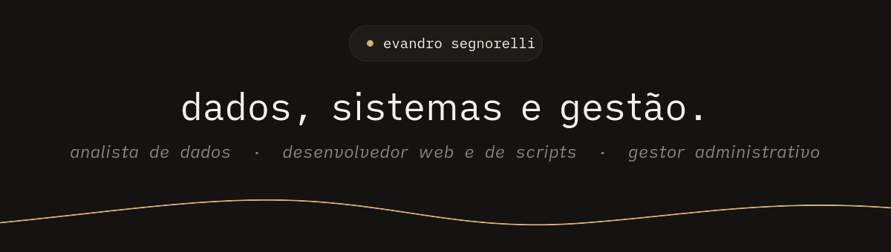

Analista de dados e gestor administrativo no <b>Conglomerado BGPF Group</b>. 
Comecei no código como MEI, desenvolvendo os sistemas da rede <b>Hora do Pastel</b>, 
depois de mais de dez anos cuidando de gente, estoque e processo do lado de dentro da operação.

<a href="https://github.com/Esegnorelli">github</a> ·
<a href="https://instagram.com/Esegnorelli">instagram</a> ·
<a href="https://linkedin.com/in/Esegnorelli">linkedin</a> ·
<a href="https://twitter.com/Esegnorelli">x</a>

<table align="center">
  <tr>
    <td width="33%" valign="top">
      <b>dados</b> 
      Transformo planilha solta em número que decide: análise, indicadores e dashboards de faturamento, com Excel avançado no bolso.
    </td>
    <td width="33%" valign="top">
      <b>sistemas</b> 
      Desenvolvimento web e scripts que tiram o trabalho repetitivo da mão de quem opera. Nas horas vagas, o meu desktop Linux: <a href="https://github.com/Esegnorelli/omarchy-ilha"><code>omarchy-ilha</code></a> e <a href="https://github.com/Esegnorelli/omarchy-dunes-theme"><code>omarchy-dunes-theme</code></a>.
    </td>
    <td width="33%" valign="top">
      <b>gestão</b> 
      Pessoas, recursos materiais, terceirizados e risco. Sei o que o sistema precisa fazer porque já estive do outro lado do balcão.
    </td>
  </tr>
</table>

<table align="center">
  <tr>
    <td colspan="2" align="center">
      
    </td>
  </tr>
  <tr>
    <td width="50%" align="center">
      
    </td>
    <td width="50%" align="center">
      
    </td>
  </tr>
  <tr>
    <td width="50%" align="center">
      
    </td>
    <td width="50%" align="center">
      
    </td>
  </tr>
</table>

<b>trajetória</b> · da operação ao código

 

| quando | onde | o quê |
|---|---|---|
| hoje | Conglomerado BGPF Group | Analista de dados e gestor administrativo |
| — | Rede Hora do Pastel · MEI | Desenvolvedor de sistemas: web, scripts e o [dashboard de faturamento](https://github.com/Esegnorelli/hora-do-pastel-faturamento) |
| 2019 – 2020 | Tais Comércio de Pastéis NH | Gerente administrativo |
| 2016 – 2017 | Rex Comércio de Alimentos | Gerente administrativo |
| 2016 – 2017 | Val Belluna Comércio de Alimentos | Gerente de restaurante |
| 2013 – 2015 | Kipel Vedações Hidráulicas e Pneumáticas | Vendedor |
| 2012 | Industrial Metalúrgica Rotamil | Programador de controle de produção |
| 2007 – 2012 | Endosul | Analista de planejamento industrial |

**Formação** · Bacharel em Administração (FSG, 2016) · Tecnólogo em Processos Gerenciais (Feevale, 2022) 
**Idiomas** · português, inglês e espanhol

<b>atividade recente</b> · repositórios, pull requests e estrelas

#### na bancada

- [Esegnorelli/omarchy-ilha](https://github.com/Esegnorelli/omarchy-ilha) - Floating island bar for Omarchy: a clock at rest, one status line on hover, one panel at a time.
- [Esegnorelli/hora-do-pastel-faturamento](https://github.com/Esegnorelli/hora-do-pastel-faturamento) - Dashboard de faturamento da rede Hora do Pastel · Next.js + Supabase + Vercel
- [Esegnorelli/omarchy-dunes-theme](https://github.com/Esegnorelli/omarchy-dunes-theme) - Dunes — theme for Omarchy
- [Esegnorelli/devlinks](https://github.com/Esegnorelli/devlinks)

#### por ordem de chegada

- [Esegnorelli/omarchy-ilha](https://github.com/Esegnorelli/omarchy-ilha) - Floating island bar for Omarchy: a clock at rest, one status line on hover, one panel at a time.
- [Esegnorelli/omarchy-dunes-theme](https://github.com/Esegnorelli/omarchy-dunes-theme) - Dunes — theme for Omarchy
- [Esegnorelli/devlinks](https://github.com/Esegnorelli/devlinks)
- [Esegnorelli/hora-do-pastel-faturamento](https://github.com/Esegnorelli/hora-do-pastel-faturamento) - Dashboard de faturamento da rede Hora do Pastel · Next.js + Supabase + Vercel

#### no código dos outros

- [Priority: live OmaCapy page shows a broken tofu preview](https://github.com/omacom/omarchy-plugin-marketplace/pull/120) em [omacom/omarchy-plugin-marketplace](https://github.com/omacom/omarchy-plugin-marketplace)

#### de olho

- [NousResearch/hermes-agent](https://github.com/NousResearch/hermes-agent) - The agent that grows with you
- [openclaw/openclaw](https://github.com/openclaw/openclaw) - The AI that really does things. Any OS. Any Platform. The lobster way. 🦞
- [omerxx/catppuccin-tmux](https://github.com/omerxx/catppuccin-tmux) - 💽 Soothing pastel theme for Tmux!
- [code-yeongyu/oh-my-openagent](https://github.com/code-yeongyu/oh-my-openagent) - OmO: Just type "mass ulw" keyword with your prompt. Now you are the master of graph engineering.
- [luizomf/otaviomiranda.com.br](https://github.com/luizomf/otaviomiranda.com.br) - My personal site and blog. All code, posts, and history are open.

