  

  Analista de dados e gestor administrativo no <b>Conglomerado BGPF Group</b>. 
  Comecei a programar como MEI, construindo os sistemas da rede <b>Hora do Pastel</b>. 
  Nas horas vagas, faço o meu próprio desktop Linux: a barra <a href="https://github.com/Esegnorelli/omarchy-ilha">omarchy-ilha</a> e o tema <a href="https://github.com/Esegnorelli/omarchy-dunes-theme">omarchy-dunes-theme</a>.

  <a href="https://linkedin.com/in/Esegnorelli"><b>LinkedIn</b></a> &nbsp;·&nbsp;
  <a href="https://instagram.com/Esegnorelli"><b>Instagram</b></a> &nbsp;·&nbsp;
  <a href="https://twitter.com/Esegnorelli"><b>X</b></a>

  

<b>atividade recente</b> · repositórios, pull requests e estrelas

#### na bancada

- [Esegnorelli/omarchy-ilha](https://github.com/Esegnorelli/omarchy-ilha) - Floating island bar for Omarchy: a clock at rest, one status line on hover, one panel at a time.
- [Esegnorelli/hora-do-pastel-faturamento](https://github.com/Esegnorelli/hora-do-pastel-faturamento) - Dashboard de faturamento da rede Hora do Pastel · Next.js + Supabase + Vercel
- [Esegnorelli/omarchy-dunes-theme](https://github.com/Esegnorelli/omarchy-dunes-theme) - Dunes — theme for Omarchy
- [Esegnorelli/devlinks](https://github.com/Esegnorelli/devlinks)

#### por ordem de chegada

- [Esegnorelli/omarchy-ilha](https://github.com/Esegnorelli/omarchy-ilha) - Floating island bar for Omarchy: a clock at rest, one status line on hover, one panel at a time.
- [Esegnorelli/omarchy-dunes-theme](https://github.com/Esegnorelli/omarchy-dunes-theme) - Dunes — theme for Omarchy
- [Esegnorelli/devlinks](https://github.com/Esegnorelli/devlinks)
- [Esegnorelli/hora-do-pastel-faturamento](https://github.com/Esegnorelli/hora-do-pastel-faturamento) - Dashboard de faturamento da rede Hora do Pastel · Next.js + Supabase + Vercel

#### no código dos outros

- [Priority: live OmaCapy page shows a broken tofu preview](https://github.com/omacom/omarchy-plugin-marketplace/pull/120) em [omacom/omarchy-plugin-marketplace](https://github.com/omacom/omarchy-plugin-marketplace)

#### de olho

- [NousResearch/hermes-agent](https://github.com/NousResearch/hermes-agent) - The agent that grows with you
- [openclaw/openclaw](https://github.com/openclaw/openclaw) - The AI that really does things. Any OS. Any Platform. The lobster way. 🦞
- [omerxx/catppuccin-tmux](https://github.com/omerxx/catppuccin-tmux) - 💽 Soothing pastel theme for Tmux!
- [code-yeongyu/oh-my-openagent](https://github.com/code-yeongyu/oh-my-openagent) - OmO: Just type "mass ulw" keyword with your prompt. Now you are the master of graph engineering.
- [luizomf/otaviomiranda.com.br](https://github.com/luizomf/otaviomiranda.com.br) - My personal site and blog. All code, posts, and history are open.

