# Esegnorelli | Devlinks

**Evandro Segnorelli**

[GitHub](https://github.com/Esegnorelli) · [LinkedIn](https://linkedin.com/in/Esegnorelli) · [Instagram](https://instagram.com/Esegnorelli) · [Twitter](https://twitter.com/Esegnorelli) · [Devlinks](https://esegnorelli.github.io/devlinks/)

Sou analista de dados e programador na rede **Hora do Pastel**, onde comecei como gerente de loja. Também sou analista administrativo no **Conglomerado BGPF Group**.

Antes de programar, trabalhei com análise de dados na Endosul, vendas na Kipel e gerência no McDonald's (Arcos Dourados). Hoje junto as duas coisas: SQL, TypeScript, dashboards e scripts que automatizam a rotina da operação.

Nas horas vagas, mexo no meu desktop Linux com [Omarchy](https://omarchy.org): fiz a barra [omarchy-ilha](https://github.com/Esegnorelli/omarchy-ilha) e o tema [omarchy-dunes-theme](https://github.com/Esegnorelli/omarchy-dunes-theme).

### Stack

- **Dados:** SQL, PostgreSQL (PL/pgSQL), Supabase, dashboards de operação
- **Web:** TypeScript, React, Vite, Tailwind CSS, JavaScript, HTML e CSS
- **Automação:** Python, GitHub Actions
- **Desktop:** Linux, Hyprland, [Omarchy](https://omarchy.org), QML

### Projetos públicos

- [Esegnorelli/hora-do-pastel-painel](https://github.com/Esegnorelli/hora-do-pastel-painel) · JavaScript · [site](https://hora-do-pastel-painel.vercel.app)
- [Esegnorelli/devlinks](https://github.com/Esegnorelli/devlinks) - Agregador de links como cartão de visitas online, com tema claro/escuro · HTML · [site](https://esegnorelli.github.io/devlinks/)
- [Esegnorelli/omarchy-ilha](https://github.com/Esegnorelli/omarchy-ilha) - Floating island bar for Omarchy: a clock at rest, one status line on hover, one panel at a time. · QML
- [Esegnorelli/hora-do-pastel-faturamento](https://github.com/Esegnorelli/hora-do-pastel-faturamento) - Dashboard de faturamento da rede Hora do Pastel · React + Vite + Supabase + Vercel · TypeScript · [site](https://hora-do-pastel-faturamento.vercel.app)
- [Esegnorelli/omarchy-dunes-theme](https://github.com/Esegnorelli/omarchy-dunes-theme) - Dunes: tema para o Omarchy

Mais atividade

#### Pull requests recentes

- [Ilha 1.2.0: ícones embutidos e pílula sem passo de instalação](https://github.com/Esegnorelli/omarchy-ilha/pull/1) em [Esegnorelli/omarchy-ilha](https://github.com/Esegnorelli/omarchy-ilha)

#### Estrelas recentes

- [NousResearch/hermes-agent](https://github.com/NousResearch/hermes-agent) - The agent that grows with you
- [openclaw/openclaw](https://github.com/openclaw/openclaw) - The AI that really does things. Any OS. Any Platform. The lobster way. 🦞
- [omerxx/catppuccin-tmux](https://github.com/omerxx/catppuccin-tmux) - 💽 Soothing pastel theme for Tmux!
- [code-yeongyu/oh-my-openagent](https://github.com/code-yeongyu/oh-my-openagent) - OmO: Just type "mass ulw" keyword with your prompt. Now you are the master of graph engineering.
- [luizomf/otaviomiranda.com.br](https://github.com/luizomf/otaviomiranda.com.br) - My personal site and blog. All code, posts, and history are open.

